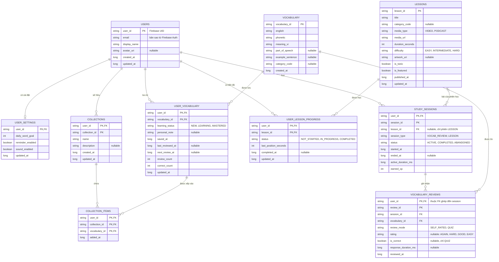

# ERD đề xuất — VocabLens

Trạng thái: đã triển khai cấu trúc 10 bảng và DAO trong Room, database mới `vocab_lens_app.db`, version 1. Chưa có UI quản lý bộ sưu tập, trình phát bài học hoặc đánh giá flashcard; các phần này dùng API lưu trữ khi được triển khai.
Theo yêu cầu, không có migration từ database cũ. Schema Room xuất trong `app/schemas/` là tham chiếu chính xác cho tên cột vật lý: sơ đồ dùng snake_case, còn Entity/cột hiện dùng camelCase tương ứng (ví dụ `user_id` → `userId`).

## Phạm vi và giả định

Bản tổng thể gồm 10 bảng: tài khoản, cài đặt, kho từ vựng, sổ từ cá nhân, bộ sưu tập, từ trong bộ, bài học, tiến độ bài học, phiên học và lịch sử ôn từ.
Mỗi bộ sưu tập thuộc một người dùng và chưa có chức năng chia sẻ.
Một từ đã lưu có thể chưa thuộc bộ sưu tập nào, hoặc nằm trong nhiều bộ sưu tập của cùng người dùng.
Trạng thái học thuộc về cặp người dùng–từ vựng, dùng chung giữa các bộ sưu tập.

`User.user_id` chính là Firebase Authentication UID. Bảng `users` là bản hồ sơ local để liên kết dữ liệu, không thay thế Firebase Authentication và không chứa mật khẩu/token.
Đây là mô hình dữ liệu local trên từng thiết bị; chưa cung cấp đồng bộ giữa các thiết bị.

## Sơ đồ tổng thể

PK: khóa chính. FK: khóa ngoại. Dấu `?` trong mô tả nghĩa là có thể null.
Các cột cùng đánh dấu PK tạo thành một khóa chính ghép.

## Ý nghĩa từng bảng

| Bảng | Vai trò | Ví dụ |
|---|---|---|
| `users` | Hồ sơ local của tài khoản Firebase | UID của An, tên, email |
| `user_settings` | Cài đặt riêng; nếu chưa có bản ghi thì dùng mặc định | Mục tiêu 25 từ/ngày, bật âm thanh |
| `vocabulary` | Nội dung từ/ý nghĩa; dùng lại giữa nhiều người dùng và bộ sưu tập trên thiết bị | `book` – danh từ – quyển sách |
| `user_vocabulary` | Từ đã lưu, ghi chú và trạng thái học của một người | An đang học `book`; Bình chưa học |
| `collections` | Bộ sưu tập do một người tạo | “TOEIC”, “Đồ vật trong nhà” |
| `collection_items` | Liên kết từ đã lưu với bộ sưu tập cùng chủ | Từ `book` của An nằm trong cả hai bộ |
| `lessons` | Nội dung video/podcast dùng chung | Video giao tiếp 5 phút |
| `user_lesson_progress` | Trạng thái và vị trí xem riêng của từng người | An xem đến giây 120; Bình đến giây 40 |
| `study_sessions` | Một lần học/ôn với thời gian hoạt động và XP | An ôn từ trong 10 phút |
| `vocabulary_reviews` | Một lần trả lời hoặc tự đánh giá một từ trong phiên | An trả lời đúng từ `book` |

Mỗi bản ghi `vocabulary` biểu diễn một mục từ với một nghĩa và từ loại. Không đặt UNIQUE cho riêng `english`: `book` có thể là danh từ hoặc động từ với nghĩa khác nhau.
Nội dung dùng chung không chứa ghi chú hay tiến độ cá nhân. Bản đầu không cho sửa nội dung dùng chung trực tiếp; người dùng sửa `personal_note`, hoặc tạo mục từ mới nếu muốn nội dung khác.
`category_code` giữ được các nhóm hiện tại như `Objects`, `Technology`, `Travel`; nhóm này khác với bộ sưu tập người dùng tự tạo. Có thể tách bảng category sau nếu cần quản lý nhiều nhóm hoặc quan hệ nhiều–nhiều.

## Khóa ngoại và ràng buộc

| Bảng con | Cột FK | Tham chiếu | Khi xóa bản ghi cha |
|---|---|---|---|
| `user_settings` | `user_id` | `users(user_id)` | CASCADE |
| `user_vocabulary` | `user_id` | `users(user_id)` | CASCADE |
| `user_vocabulary` | `vocabulary_id` | `vocabulary(vocabulary_id)` | RESTRICT |
| `collections` | `user_id` | `users(user_id)` | CASCADE |
| `collection_items` | `(user_id, collection_id)` | `collections(user_id, collection_id)` | CASCADE |
| `collection_items` | `(user_id, vocabulary_id)` | `user_vocabulary(user_id, vocabulary_id)` | CASCADE |
| `user_lesson_progress` | `user_id` | `users(user_id)` | CASCADE |
| `user_lesson_progress` | `lesson_id` | `lessons(lesson_id)` | RESTRICT |
| `study_sessions` | `user_id` | `users(user_id)` | CASCADE |
| `study_sessions` | `lesson_id` (nullable) | `lessons(lesson_id)` | RESTRICT |
| `vocabulary_reviews` | `(user_id, session_id)` | `study_sessions(user_id, session_id)` | CASCADE |
| `vocabulary_reviews` | `vocabulary_id` | `vocabulary(vocabulary_id)` | RESTRICT |

Hai FK ghép của `collection_items` bắt buộc bộ sưu tập và từ đã lưu phải thuộc cùng một người. Không chỉ kiểm tra quyền sở hữu ở giao diện.

- UUID dạng TEXT cho các ID nội dung/sự kiện; `user_id` lấy nguyên Firebase UID. Các PK ghép được giữ như sơ đồ.
- Timestamp lưu số mili giây UTC, đổi sang múi giờ địa phương khi hiển thị.
- `name` và `english` không được trống sau khi trim. Bản đầu cho phép tên bộ sưu tập trùng nhau vì ID mới là định danh.
- `daily_word_goal > 0`; `0 <= correct_count <= review_count`.
- `learning_status` chỉ nhận các giá trị được định nghĩa. Chưa suy ra MASTERED từ một ngưỡng tùy ý; cần chốt quy tắc ôn tập trước khi triển khai.
- Index `user_vocabulary(vocabulary_id)` cho FK; thêm `(user_id, saved_at)` và `(user_id, next_review_at)` theo truy vấn.
- PK của `collection_items` hỗ trợ FK đến collection; thêm index `(user_id, vocabulary_id)` cho FK và truy vấn ngược.
- Index `user_lesson_progress(lesson_id)`, `study_sessions(lesson_id)`; `(user_id, started_at)` cho lịch sử theo ngày.
- Index `vocabulary_reviews(user_id, session_id)` cho FK ghép, `(vocabulary_id)` cho FK và `(user_id, vocabulary_id, reviewed_at)` cho lịch sử ôn một từ.
- Các quy tắc kiểm tra phải được thực thi trong use case/transaction; bổ sung CHECK ở SQLite khi triển khai nếu phù hợp. Annotation Entity đơn thuần không bảo đảm các quy tắc nghiệp vụ này.

## Luồng sử dụng

1. Sau đăng nhập: upsert hồ sơ `users` từ Firebase trước khi lưu dữ liệu có FK. UID phải lấy từ phiên xác thực hiện tại, không từ một giá trị nhập trên UI.
2. Lưu từ vào sổ: tìm/tạo nội dung `vocabulary`, rồi tạo `user_vocabulary` với trạng thái NEW trong cùng transaction. Nếu đã lưu, giữ nguyên tiến độ và `saved_at`.
3. Thêm vào bộ sưu tập: kiểm tra collection thuộc UID hiện tại, bảo đảm từ có trong sổ, rồi thêm `collection_items` trong transaction. Không cho thêm trùng cùng từ vào cùng bộ.
4. Xóa từ khỏi một bộ: chỉ xóa `collection_items`; từ vẫn còn trong sổ và các bộ khác.
5. Xóa bộ sưu tập: xóa collection và các item qua CASCADE; giữ `user_vocabulary` và tiến độ.
6. Xóa từ khỏi sổ: xóa `user_vocabulary`; item ở tất cả bộ của người đó tự xóa. Từ trong sổ người khác không bị ảnh hưởng. Chưa tự xóa nội dung `vocabulary` mồ côi.
7. Ôn tập: cập nhật tiến độ theo `(user_id, vocabulary_id)`, không theo collection. Khi thêm lịch sử ôn tập, ghi sự kiện và cập nhật tổng hợp trong cùng transaction.
8. Đăng xuất: hủy luồng quan sát và xóa dữ liệu đang hiển thị; mặc định giữ database local để đăng nhập lại. Xóa hồ sơ local không đồng nghĩa xóa tài khoản Firebase.

## Bài học, phiên học và lịch sử ôn

### Bài học và tiến độ

`lessons` chỉ chứa nội dung dùng chung; `user_lesson_progress` chứa dữ liệu cá nhân. Khi chưa có progress thì coi bài là NOT_STARTED.
`last_position_seconds` là vị trí tiếp tục phát, không phải tổng thời gian đã học. Giá trị phải nằm từ 0 đến thời lượng bài, kiểm tra trong transaction/use case khi ghi.
`completed_at` chỉ có giá trị khi status COMPLETED. Cần chốt điều kiện hoàn thành (xem hết hoặc đạt ngưỡng) trước khi triển khai, không mặc định một phần trăm tùy ý.
Xem lại bài đã hoàn thành không tự xóa trạng thái hoàn thành; chỉ reset khi có thao tác rõ ràng.

### Phiên học

Mỗi `study_sessions` thuộc một UID. Một phiên chỉ học một bài hoặc ôn từ; không trộn hai loại trong một phiên.
- `session_type = LESSON`: `lesson_id` bắt buộc có giá trị.
- `session_type = VOCAB_REVIEW`: `lesson_id` phải null; chỉ phiên loại này nhận bản ghi `vocabulary_reviews`.
- `active_duration_ms >= 0`, loại trừ thời gian tạm dừng/chạy nền. Không suy thời gian học bằng chênh lệch đồng hồ bắt đầu/kết thúc.
- ACTIVE có `ended_at = null`; COMPLETED và ABANDONED phải có `ended_at >= started_at`.
- `earned_xp >= 0`; bản đầu chỉ cấp XP khi phiên COMPLETED, các trạng thái khác giữ 0. Chuyển trạng thái và cấp XP trong một transaction, không cộng lặp khi retry. Công thức XP còn cần chốt.
- Phiên ACTIVE bị gián đoạn khi app đóng được phục hồi hoặc đánh dấu ABANDONED theo chính sách sau này; chưa tự tính là hoàn thành.

### Một lượt ôn từ

Mỗi `vocabulary_reviews` có đúng một phiên cùng UID và một mục từ. FK ghép `(user_id, session_id)` ngăn gắn lượt ôn của người này vào phiên người khác.
Trước khi ghi lượt ôn, use case kiểm tra phiên thuộc UID hiện tại, còn ACTIVE, có loại VOCAB_REVIEW và từ đang trong sổ của người đó. Bản đầu không cho bỏ lưu từ khi phiên đang ôn từ đó chưa kết thúc.

- SELF_RATED: `rating` bắt buộc là AGAIN/HARD/GOOD/EASY; `is_correct = null`. Phù hợp với flashcard tự đánh giá.
- QUIZ: `is_correct` bắt buộc true/false; `rating = null`. Chỉ dùng khi có câu hỏi và đáp án thật.
- Không coi bấm “Hiện nghĩa” hoặc “Từ tiếp theo” là trả lời đúng.
- `response_duration_ms`, nếu có, phải không âm. Thời điểm review phải thuộc khoảng thời gian phiên (nếu phiên đã đóng).
- Ghi review và cập nhật `user_vocabulary` trong cùng transaction: `review_count` đếm các review, `correct_count` chỉ đếm QUIZ đúng; `last_reviewed_at` cập nhật theo sự kiện mới nhất. Dùng `review_id` để chống ghi trùng/cộng đếm lặp khi retry.
- Lịch ôn tiếp và MASTERED cần quy tắc riêng; chưa chốt thuật toán spaced repetition trong ERD này.

**Giữ lịch sử khi bỏ lưu từ:** review tham chiếu trực tiếp `vocabulary`, không có FK đến `user_vocabulary`. Vì vậy xóa từ khỏi sổ không xóa lịch sử phiên/review hoặc XP đã nhận. Không xóa cứng nội dung từ còn được review tham chiếu (RESTRICT). Khi lưu lại từ cũ, khôi phục bộ đếm và thời điểm ôn gần nhất từ lịch sử; lịch hẹn và trạng thái học áp dụng chính sách ôn tập được chọn sau này.
Không cung cấp thao tác xóa riêng từng review/phiên trong bản đầu; nếu bổ sung thì phải cập nhật tổng hợp tương ứng trong transaction. Xóa hồ sơ local của người dùng xóa toàn bộ dữ liệu local liên quan qua CASCADE, không tự xóa tài khoản Firebase.

### Thống kê

Streak lấy các ngày có phiên COMPLETED với thời gian hoạt động dương; ranh giới ngày phải thống nhất theo múi giờ học được chọn (bản đầu dùng múi giờ thiết bị).
Tổng XP lấy SUM(earned_xp) từ các phiên COMPLETED. Thời gian học lấy SUM(active_duration_ms) của các phiên đã đóng, gồm cả ABANDONED nếu có hoạt động thật. Không tính hai lần các phiên trùng thời gian hoạt động.
Số từ đã lưu lấy từ `user_vocabulary`; số từ đã thuộc lấy trạng thái MASTERED; số từ đã ôn hôm nay lấy DISTINCT vocabulary_id trong review theo ngày. Các chỉ số này không thay thế lẫn nhau.
Chưa cần bảng `dashboard` chứa số liệu demo. Có thể thêm bảng tổng hợp sau khi có nhu cầu hiệu năng và cơ chế cập nhật nhất quán.

## Các chức năng chưa cần bảng riêng

Phát âm TTS hiện tại không cần bảng riêng. Chỉ thêm bảng kết quả phát âm nếu sau này có thu âm/chấm điểm. Camera/nhận diện cũng chỉ cần bảng lịch sử riêng khi có yêu cầu lưu lần quét.

## Ánh xạ vào code Room

- `SavedVocabularyEntity` cũ đã được thay bằng `VocabularyEntity` + `UserVocabularyEntity`.
- `VocabularyWord` vẫn có thể là domain model cho giao diện, được tạo từ phép JOIN. Không cần ép mỗi domain model thành một bảng.
- `UserProfile` lấy hồ sơ/cài đặt từ `users`, `user_settings`; các chỉ số học lấy từ dữ liệu học hoặc kết quả tổng hợp.
- `PracticeLesson.progress` được tạo sau khi JOIN `lessons` và `user_lesson_progress`; dữ liệu cá nhân được lưu trong bảng progress.
- Thêm Entity trong `data/local/entity`; DAO và transaction trong `data/local/dao`; implementation ở `data/repository` giữ đuôi `Impl`. Domain không phụ thuộc annotation Room.
- Database mới có tên file khác; không đọc hoặc xóa database/SharedPreferences cũ, không chuyển dữ liệu cũ sang và không seed dữ liệu mẫu.
- Hồ sơ local được tạo từ tài khoản Firebase thật trước khi sử dụng dữ liệu con có FK.
- Các test database kiểm tra FK chống liên kết khác chủ, dữ liệu nhiều tài khoản, thêm trùng, quy tắc xóa và lịch sử học. Không có migration để test trong lần thay database này.

## Điểm cần chốt với người dùng

1. Bộ sưu tập riêng hay có chia sẻ? Nếu chia sẻ, bổ sung thành viên/quyền truy cập và tách quyền sở hữu nội dung bộ khỏi tiến độ cá nhân; schema item hiện tại cần điều chỉnh.
2. Mỗi từ có cần nhiều nghĩa, nhiều ví dụ/ảnh không? Bản đầu dùng một nghĩa và một ví dụ trên một mục từ.
3. Ôn tập theo lịch tự động hay đánh dấu đã thuộc thủ công? Quy tắc này quyết định các cột tiến độ nâng cao.
